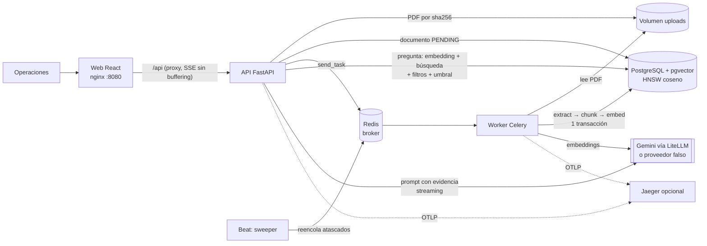

# Norvia Freight · Asistente RAG de contratos

[](https://github.com/medaimyrv/norvia-contracts-rag/actions/workflows/ci.yml)

MVP para que el equipo de operaciones suba contratos y anexos de tarifas en PDF, el sistema los
procese en segundo plano y responda preguntas en lenguaje natural **en streaming**, con **citas
verificables** (documento, versión y páginas) o con un explícito **«no encuentro evidencia»**.

- Especificación con requisitos numerados: [`docs/SPEC.md`](docs/SPEC.md)
- Decisiones, alternativas y uso de IA: [`DECISIONS.md`](DECISIONS.md)
- Evaluación de recuperación: [`eval/RESULTS.md`](eval/RESULTS.md)

## Arranque rápido

Requisitos: Docker con Compose v2. Nada más (ni Python ni Node en el host).

```bash
git clone https://github.com/medaimyrv/norvia-contracts-rag.git
cd norvia-contracts-rag
docker compose up --build
```

| Qué | Dónde |
|---|---|
| Aplicación web | <http://localhost:8080> |
| API (OpenAPI) | <http://localhost:8000/docs> |

Al arrancar, el servicio `seed` sube por la API los 5 contratos sintéticos de `samples/` y el
worker los procesa en unos segundos. **Sin clave funciona en modo demostración** (aviso visible en
la web): la búsqueda compara palabras y las respuestas son frases copiadas del documento con su cita.

### Con un modelo real (Gemini)

```bash
cp .env.example .env
# en .env: MODEL_PROVIDER=gemini y GEMINI_API_KEY=<tu clave de https://aistudio.google.com>
docker compose up --build
```

> Los vectores de modelos distintos no son comparables. Si cambias de proveedor con documentos ya
> cargados, la web avisa («⚠ N documentos por actualizar») y permite **reprocesarlos** con el botón
> «Actualizar ahora».
> `.env.example` usa la misma contraseña de base de datos que el arranque sin `.env`, así que
> copiarlo no rompe una base de datos ya creada. Si cambias `POSTGRES_PASSWORD` después del primer
> arranque, recrea el volumen: `docker compose down -v` (los documentos de ejemplo se recargan solos).

**Pruebas manuales:** [`pruebas_manuales/`](pruebas_manuales/) incluye PDFs de prueba (transportista
nuevo, versión nueva, versión futura, duplicado, conflicto de versión, no-PDF, corrupto, escaneado,
prompt injection) y [`GUIA.md`](pruebas_manuales/GUIA.md) indica qué datos usar con cada uno y qué
debe pasar.

Preguntas de ejemplo: «¿Cuál es el plazo de reclamación por mercancía dañada con Cóndor Andino?»,
«¿Cuánto cuesta un envío de 5000 kg de Sevilla a Málaga con Vientos del Sur?», «¿Cuánto tiempo
tengo para quejarme si la carga llega rota con Cóndor Andino?» (paráfrasis, requiere Gemini).

## Arquitectura



Arquitectura hexagonal ligera ([D0](DECISIONS.md)): `domain/` (reglas puras: chunking, política de
evidencia, resolución de transportista), `ports/` (Protocols), `adapters/` (pdfplumber, LiteLLM,
pgvector, fakes), `services/` (ingesta, documentos, chat) y `api/` + `worker/` como capas delgadas.

**Formulario:** al elegir un PDF, la web propone transportista, código, versión y vigencia leídos
de la portada (`POST /api/documents/suggest`) y la persona los confirma ([D19](DECISIONS.md)).
Son necesarios para filtrar por transportista, decidir la versión vigente y citar la versión.

**Ingesta:** `POST /api/documents` valida (tipo por *magic bytes*, tamaño, metadatos estrictos),
guarda el PDF, crea la fila `PENDING` y encola. El worker extrae texto y tablas por página
(pdfplumber), trocea por cláusula con tablas en bloques con cabecera repetida, calcula embeddings
con una cabecera de contexto y escribe todo en **una transacción**. Estado en PostgreSQL, no en Celery.

**Chat:** `POST /api/chat` (SSE). Resuelve el transportista de la pregunta («¿Quisiste decir…?» si
es parecido), busca en pgvector con filtros (transportista, versión vigente), y si la mejor
puntuación no supera el umbral responde «sin evidencia» **sin llamar al LLM**. Si la supera, el LLM
responde en streaming con marcadores `[c1]` y un JSON validado con Pydantic estricto; las citas a
fragmentos no recuperados se descartan.

## Variables de entorno

Todas en [`.env.example`](.env.example); ninguna es obligatoria para arrancar.

| Variable | Por defecto | Para qué |
|---|---|---|
| `MODEL_PROVIDER` | `fake` | `fake` (sin red ni claves) o `gemini` |
| `GEMINI_API_KEY` | — | Obligatoria con `gemini`; solo en `.env` (git-ignorado) |
| `LLM_MODEL` / `EMBEDDING_MODEL` | `gemini/gemini-3.5-flash-lite` / `gemini/gemini-embedding-001` | Modelos vía LiteLLM |
| `EMBEDDING_DIM` | `768` | Fijada en la migración; si no coincide, la app no arranca |
| `RETRIEVAL_K` | `6` | Fragmentos recuperados por pregunta |
| `RELEVANCE_THRESHOLD` | vacío | Vacío = calibrado por proveedor y tipo de pregunta (gemini 0,70 si nombra transportista / 0,63 general · fake 0,25) |
| `MAX_UPLOAD_MB` | `20` | Tamaño máximo de PDF |
| `LLM_TIMEOUT_S` | `30` | Timeout de cada llamada al proveedor |
| `OTEL_EXPORTER` | `console` | `console` o `otlp` (Jaeger) |
| `OTEL_CAPTURE_CONTENT` | `false` | Incluir preguntas y respuestas en las trazas (solo depuración) |
| `POSTGRES_USER` / `POSTGRES_PASSWORD` / `POSTGRES_DB` | `norvia` | Base de datos |

## Tests y calidad

```bash
make install            # dependencias del backend (uv)
make test               # unitarios + integración (requiere Docker: testcontainers con pgvector real)
make test-unit          # solo unitarios, sin Docker
make lint               # ruff (lint + formato)
make eval               # evaluación de recuperación (reproducible sin clave gracias a la caché)
```

- **Unitarios:** chunking (incluido el invariante «no se pierde texto» y un PDF fuera de plantilla),
  modelos Pydantic estrictos, política de evidencia y salida estructurada, resolución de
  transportista, proveedores, chat SSE con fallos simulados, trazas.
- **Integración con PostgreSQL + pgvector real** (testcontainers): esquema y migraciones (ORM ==
  migración), ingesta, tarea Celery (modo *eager*, con reintentos y agotamiento), búsqueda con
  filtros, API de documentos y una carrera real entre dos workers.
- LLM y embeddings se sustituyen por **proveedores falsos deterministas**: ningún test usa red ni claves.
- **CI** (GitHub Actions): lint + tests del backend, lint + build del frontend y build de imágenes.

## Manejo de fallos

| Caso | Comportamiento | Test |
|---|---|---|
| F1 PDF corrupto | `FAILED` · `invalid_pdf`, sin reintentos | `test_permanent_errors_mark_failed` |
| F2 PDF escaneado | `FAILED` · `no_text_layer` | `test_permanent_errors_mark_failed` |
| F3 Timeout del LLM | Evento SSE `error` · `llm_timeout` | `test_timeout_emits_error_event` |
| F4 Rate limit | Chat: 2 reintentos antes del primer token; ingesta: reintento Celery con backoff | `test_rate_limit_*`, `test_task_retries_*` |
| F5 Redis caído | Subida acepta (202, `PENDING`); el sweeper reencola; `/health/ready` lo indica | `test_redis_down_*`, `test_sweeper_*` |
| F6 BD caída | 503 `database_unavailable`; la tarea reintenta | `test_database_down_returns_503` |
| F7 Cliente cierra el SSE | Se deja de enviar y se cierra el stream del LLM | `test_client_disconnect_closes_llm_stream` |
| F8 Worker muere | Una transacción por documento; `acks_late` + sweeper reprocesan | `test_rerun_after_crash_*` |
| F9 Salida del LLM inválida | Se degrada a «sin evidencia» | `test_invalid_structured_output_degrades` |

## Seguridad

- **Archivos:** PDF verificado por *magic bytes*, tamaño limitado antes y durante la lectura, nombre
  saneado y nunca usado como ruta (se guarda por sha256).
- **Secretos:** solo por variables de entorno; `SecretStr` evita que salgan en logs o `repr`.
  LiteLLM se ejecuta con `LITELLM_MODE=PRODUCTION` para que no cargue un `.env` por su cuenta.
- **Prompt injection:** la evidencia va delimitada y marcada como datos no confiables, un documento
  no puede cerrar la etiqueta, y solo se aceptan citas a fragmentos recuperados. Probado con
  `samples/injection_test.pdf`.
- **Logs y trazas sin datos sensibles:** logs JSON; preguntas y respuestas solo como longitud y huella
  salvo `OTEL_CAPTURE_CONTENT=true`.

## Observabilidad

Por defecto cada span se escribe en los logs de `api` y `worker` (una línea JSON). Para verlas en Jaeger:

```bash
OTEL_EXPORTER=otlp docker compose --profile observability up -d    # http://localhost:16686
```

> Si Docker responde `network … not found` (el contenedor de Jaeger quedó asociado a una red
> borrada por un `docker compose down` anterior): `docker compose --profile observability rm -f jaeger`
> y repite el comando.

- **Ingesta:** `POST /api/documents` → `apply_async` → (worker) `run/ingest_document` →
  `ingest.extract` / `ingest.chunk` / `ingest.embed` / `ingest.store`. El contexto viaja en las
  cabeceras de Celery.
- **Chat:** `POST /api/chat` → `rag.chat` → `rag.embed_query` → `rag.retrieve` (→ `pgvector.search`)
  → `llm.stream`. `rag.retrieve` tiene **enlaces a la traza de ingesta** de cada documento recuperado.

**Cómo depurar una respuesta mala:**
1. Busca la traza del chat (`rag.chat`) y mira `rag.outcome`, `rag.carrier_filter` y `rag.confidence`.
2. En `rag.retrieve`: ¿`rag.top_score` frente a `rag.threshold`? ¿`rag.scores` y `rag.documents`
   contienen el documento esperado? Si no, el problema es de recuperación (chunking, filtro de
   transportista o versión vigente) y no del LLM.
3. Si el documento correcto no aparece, sigue el **enlace** a su traza de ingesta: `chunk.count`,
   `pdf.pages`, `chunk.tables` y errores de extracción.
4. Si la evidencia era buena, mira `llm.stream`: `llm.structured_output_valid`, tokens y reintentos.
   Para ver el texto exacto, repite con `OTEL_CAPTURE_CONTENT=true` (solo en local).
5. Añade la pregunta a `eval/questions.yaml` para que el caso quede cubierto.

## Estado

**Hecho:** todo lo pedido en el enunciado (ver [trazabilidad en SPEC](docs/SPEC.md)).

**Fuera de alcance (consciente):** autenticación y multiusuario, OCR de escaneados, extracción
automática de metadatos del PDF, maquetación a varias columnas, historial de conversación,
borrado de documentos desde la web, reranker y búsqueda léxica (BM25).

**Limitaciones conocidas:**
- Corpus de evaluación sintético y pequeño: las cifras orientan, no prueban.
- Con la cuota gratuita de Gemini (100 embeddings/minuto) una carga masiva se apoya en los reintentos.
- La vigencia se recalcula al ingerir: una versión con fecha futura no pasa a vigente sola el día
  que llega (haría falta una tarea diaria).
- Sin instrumentación genérica de SQL (la oficial no admite SQLAlchemy 2.1); la consulta vectorial
  tiene su propio span.
- Un único `beat`: correcto aunque se escalen los workers, pero sin alta disponibilidad.

## Estructura

```
backend/   app/{domain,ports,adapters,services,api,worker}  migrations/  tests/  scripts/
frontend/  React + Vite + Tailwind, servido por nginx
eval/      preguntas, script, caché de vectores y resultados
samples/   PDFs sintéticos (incluye corrupto, escaneado, malicioso y fuera de plantilla)
docs/      SPEC.md y TASKS.md
```
